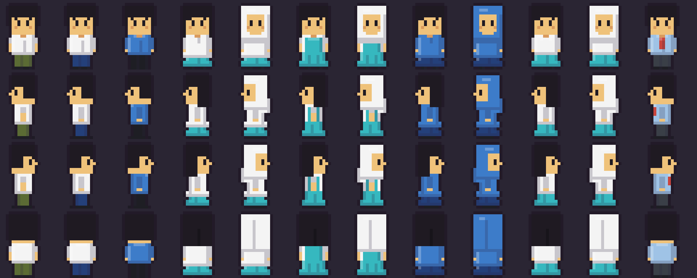

# AgentSchool — Phase 0 world prototype

A playable top-down 2D school (hallway → classroom → teacher → mock maths lesson) built on a
**domain-independent world engine**, plus an Office world that reuses the same engine unchanged.
See [ADR-009](docs/adr/ADR-009-reusable-2d-world-phase-0.md) for why Phase 0 exists and its timebox.

> **Everything interactive is mock content.** Dialogue and lessons are hand-written prototype
> scripts (badged *"Prototype script — not AI-generated"* in the UI). Exercise answers are
> **recorded, not graded**. There are no AI agents, no backend and no network calls.

## Run

Requires Node 20.19+ (tested on Node 26 / npm 11).

```bash
npm install
npx playwright install chromium   # once, for e2e tests
npm run dev                       # http://localhost:5173  (?world=office to start in the office)
```

| Script | What it does |
|---|---|
| `npm run dev` | Vite dev server |
| `npm run build` | Typecheck (`tsc -b`) + production build to `dist/` |
| `npm run preview` | Serve `dist/` on :4173 |
| `npm test` | Vitest: engine, world/map contracts, panel registry, React components (jsdom) |
| `npm run test:e2e` | Playwright against the **production build** (builds first) |
| `npm run test:all` | Both |
| `npm run assets` | Regenerate pixel art (needs Python + Pillow) and Tiled maps |
| `npm run characters:preview` | Render every uniform preset to `docs/character-presets.png` for art review |

**Controls:** WASD / arrows to move · E or Space to interact · Space/Enter to advance dialogue ·
1–9 to pick a choice · Esc to close.

## Architecture

```
src/
  environment/         reusable time-of-day layer: Malaysia time, clock / window / switch painters,
                       ambience, useEnvironment() (no engine-Phaser or domain imports; tested)
  engine/              domain-independent; may not import worlds/ or domains/ (enforced by tests)
    core/              pure TS: WorldController state machine, event bus, movement,
                       interaction probing, Tiled parsing + world validation
    phaser/            WorldScene (maps, collision, doors, NPCs, camera, animation, resize)
                       and createWorldGame()
  worlds/              data only: WorldDefinitions (rooms, spawns, actors, interaction wiring)
    school/  office/   registry.ts
  domains/             React panels registered by action kind
    school/            LessonPanel (blackboard + exercises, KaTeX), mock lesson data, progress
    office/            TaskPanel (mock checklist)
    school/uniforms/   Malaysian secondary-school uniform presets (catalog)
    office/outfits.ts  one default office outfit (reuse check)
  characters/          reusable character system; may not import worlds/, domains/, app/ (tested)
    customization/     spriteComposer (layered palette-swap renderer), palette, wardrobe ops
    components/        CharacterCreator, CharacterPreview, ColorPicker (catalog-driven)
    persistence.ts     versioned localStorage profile (schema v2) with repair + migrations
  app/                 React shell: GameView (boots Phaser, maps engine events to UI state),
                       DialogueBox, prompt, WorldSelector, PanelShell, badges, ConfirmDialog
public/
  assets/              original pixel art (tiles.png, characters/*.png, ui/indicator.png)
  maps/                Tiled 1.10 JSON maps (layers: ground, walls, furniture, objects)
```

Flow: the scene reports targets/doors → `WorldController` changes mode and emits typed
`WorldEvent`s → `GameView` renders a dialogue or looks up `DOMAIN_PANELS[action.kind]` →
the panel calls `onClose` → `controller.endInteraction()` → movement resumes.
Phaser never contains lesson, grading or business logic; React never touches Phaser objects.

## Character creation

First-time visitors to the school get the **character creator**. It covers:

- name: 24 characters, any script, `a/l` and `a/p` allowed
- gender presentation
- uniform category (Regular Secondary Student or School Prefect) and outfit style
- skin tone (six tones, light to dark, beside the name)
- sleeve length, and an **optional** headscarf (ticked by default for female outfits; untick to remove)
- per-component colours: suggested swatches first, then the full palette (always shown); "Custom colour picker" adds any colour or hex code
- live preview: four directions, idle and walking

The top bar has **Edit character** (live update, keeps your room and position) and **Reset**
(with confirmation). The saved character persists in `localStorage`, and the Office World shows
the same person in a default office outfit. Design decisions are in
[ADR-010](docs/adr/ADR-010-character-creation-and-uniforms.md) (status: proposed).



## Classroom environment

- **Wall clocks** (classroom, hallway, office) show the current **Malaysia time** (MYT, UTC+8) as analog hands.
  Interacting shows it digitally, e.g. "Current Malaysia time: 7:42 PM (MYT, UTC+8)".
- **Windows** show morning, afternoon, evening or night outside, and the room tint follows the time of day.
  The ranges are tuned for Malaysia's ~7 AM sunrise; see [interaction contracts](docs/interaction-contracts.md).
- **Desks**: all 8 classroom desks can be sat at. Press E to sit, then E or Esc to stand. Movement is locked while seated,
  and a dedicated sitting sprite is used.
- **Light switch** (classroom): toggles the room lights, which is most noticeable at night. Lights are remembered per room.
- **Flavour items**: each of the six hallway lockers and every bookshelf has its own dialogue: classroom reference shelf,
  library returns shelf, fiction corner and an office shelf. The teacher's desk has its own too. Plants are decorative.
- `?mytime=21:30` pins the clock for demos. Contracts for seats, props, effects and placeholders are in
  [docs/interaction-contracts.md](docs/interaction-contracts.md).

### Adding a world

1. Author maps in Tiled (or add a layout to `scripts/generate-maps.mjs`) with tile layers
   `ground`, `walls`, `furniture` and an object layer `objects` containing `spawn`, `door`
   (`targetRoom`, `targetSpawn`), `npc` (`actorId`) and `interactable` (`interactableId`) objects.
   Collision comes from the tileset's `collides` tile property.
2. Write a `WorldDefinition` in `src/worlds/<name>/definition.ts` and add it to `registry.ts`.
3. Register panels for any new action kinds in `src/domains/index.ts`.
   `tests/unit/worlds.test.ts` validates the maps; `tests/unit/panels.test.ts` fails if an action
   has no panel.

## Tests

- **Vitest (181):** interaction range and indicator anchoring regressions, per-object locker / shelf content, no plant zones; Malaysia time conversion (checked against the IANA zone all year), time-of-day boundaries,
  clock / window / switch painters, seat controller states, seat + prop map parsing, environment boundary; character names, palette, sprite composer (isolation of recoloured
  garments, shading, transparency, mirroring, headscarf, pinafore, no sideways clothing sway,
  skin tones), schema v1 to v2 migration, uniform presets vs. the brief,
  wardrobe operations, schema-v1 persistence and repair, creator UI (jsdom), character boundary; and movement, interaction probing, controller state machine, both worlds
  validated against their Tiled maps, engine boundary (no imports from or vocabulary of
  domains), panel registry coverage, lesson TeX validity, and jsdom component tests for the
  dialogue, lesson and task panels.
- **Playwright (32):** indicator only within one tile and gone when walking away, on the right locker or window, valid on every
  frame while walking, cleared by doors / worlds / dialogue / sitting; six different lockers and three different shelves; clock in a non-Malaysian browser time zone with live update, window views + lighting by time,
  light switch (per room), sit / stand with E and Esc, flavour items, hallway, office reuse; first-run creator with validation, custom colours and headscarf; in-game
  sprite pixel-identical to the preview; name label and dialogue; door and NPC with custom sprite;
  refresh persistence; Save; live edit; Cancel; reset with confirmation; corrupt or outdated storage;
  office reuse; plus the original world flows: walk, wall collision, noticeboard dialogue, door transition both ways,
  teacher dialogue → lesson → KaTeX → recorded answer → close → movement resumes → lesson
  resumes, "Maybe later", blackboard, office world via selector and via URL.

E2e tests drive the game with **real keyboard input**. They read state through
`window.__agentWorld` (read-only: mode, room, player snapshot) only to steer and assert.

## Known limits (deliberately out of Phase 0 scope)

- Keyboard only: no touch controls, so the game is viewable but not playable on phones.
- No pathfinding, sound or save files (ADR-009 timebox rule). Character creation was added on
  request; see ADR-010 for the timebox conflict.
- No hair-colour choice in the creator yet (the schema already stores it).
- Lesson progress lives in `sessionStorage` only.
